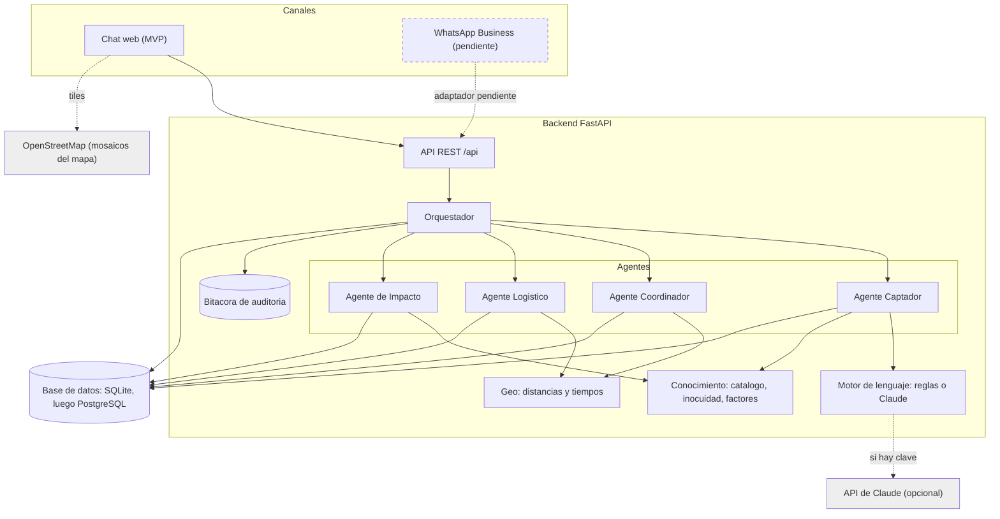
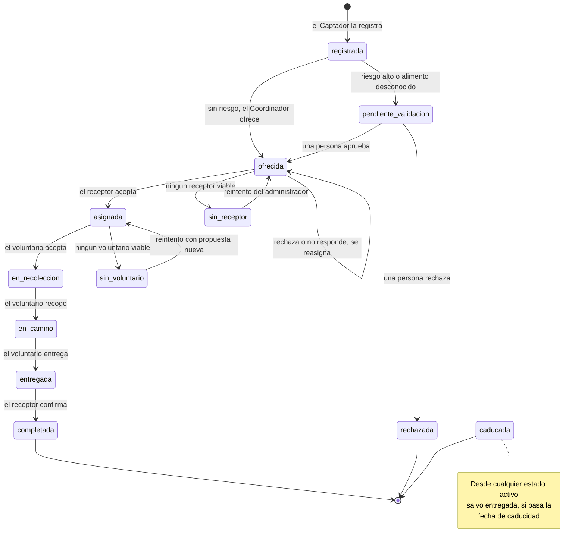
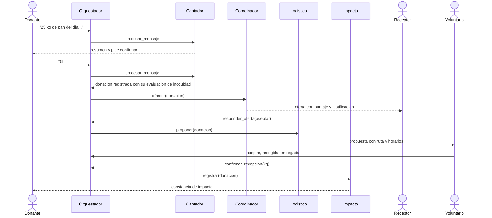
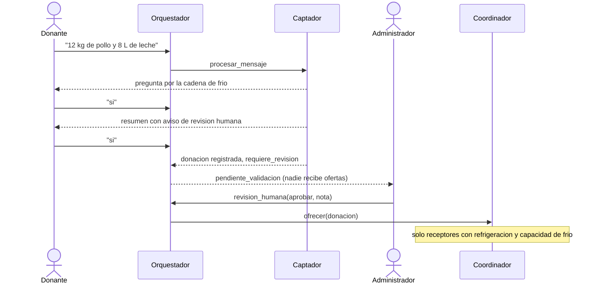
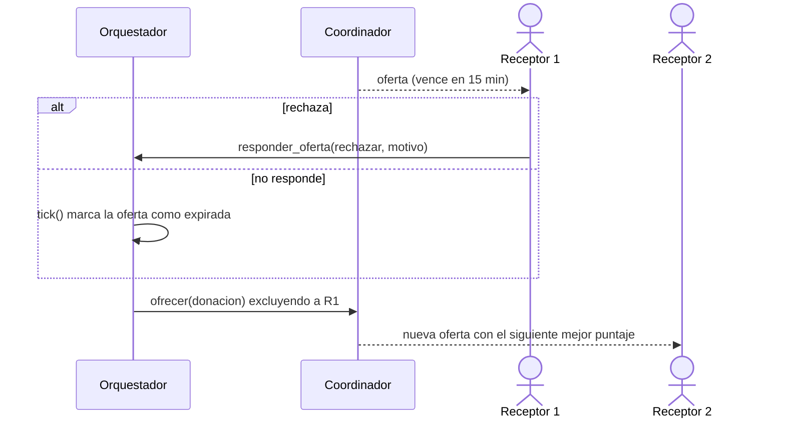
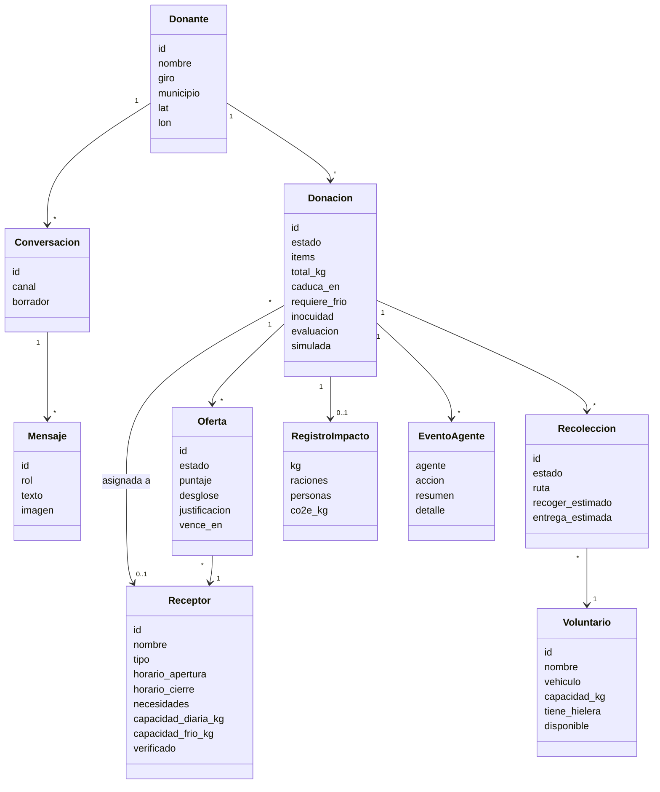
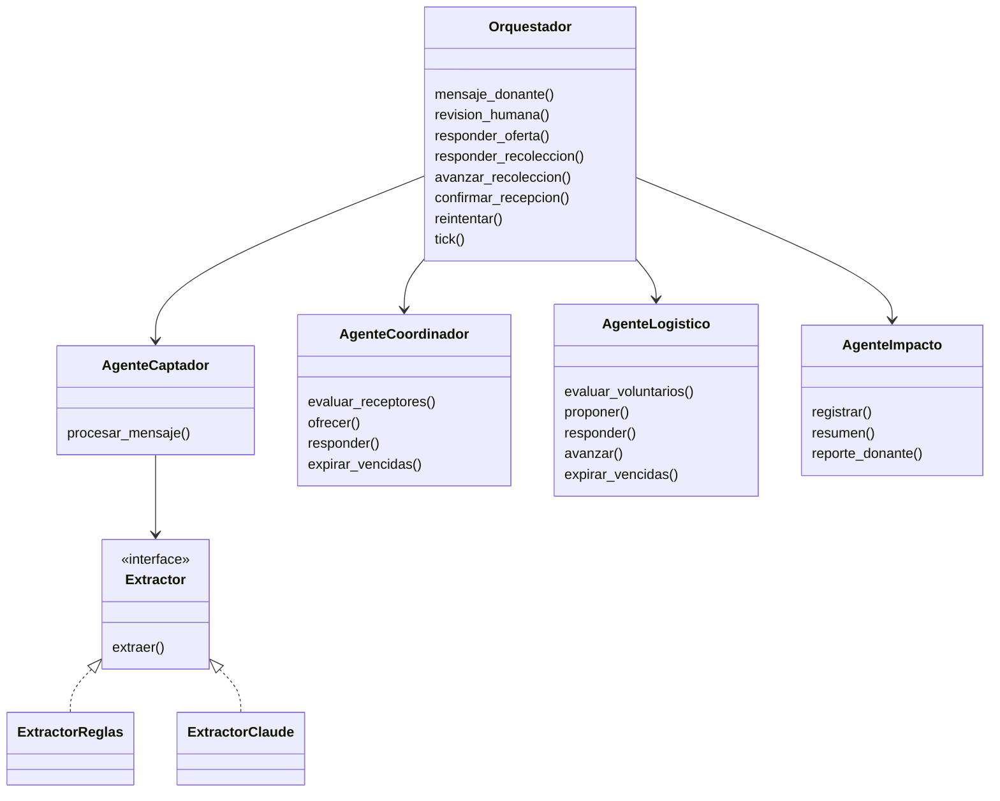

# Arquitectura de ComParte

> Borradores en Mermaid (GitHub los dibuja directamente) de los diagramas que el equipo debe entregar el
> 24 de noviembre: **componentes, estados, secuencias y clases**. Reflejan el código del MVP; si el código
> cambia, actualiza el diagrama. Para el de **casos de uso** ver [`CASOS_DE_USO.md`](CASOS_DE_USO.md).
> Mermaid sirve para revisar rápido; para la entrega final conviene redibujarlos en draw.io o PlantUML.

## 1. Diagrama de componentes

Los cuatro agentes y el orquestador son componentes separados (como pidió el profesor). Los agentes **no se
llaman entre sí**: el orquestador decide quién actúa según el estado de la donación.

| Componente | Módulo | Responsabilidad |
|---|---|---|
| Orquestador | `comparte/orquestador.py` | Enruta, pide revisión humana, aplica vencimientos, registra traspasos |
| Captador | `comparte/agentes/captador.py` | Conversación, estructura la donación, inocuidad |
| Coordinador | `comparte/agentes/coordinador.py` | Puntaje de receptores, ofertas, reasignación |
| Logístico | `comparte/agentes/logistico.py` | Voluntario, ruta, seguimiento |
| Impacto | `comparte/agentes/impacto.py` | Métricas, tablero, reporte por donante |
| Motor de lenguaje | `comparte/llm/` | `ExtractorReglas` y `ExtractorClaude` tras la misma interfaz |
| Conocimiento | `comparte/conocimiento/` | Catálogo de alimentos, reglas de inocuidad, factores de impacto |
| API | `comparte/api/` | Rutas REST y serialización |
| Interfaz | `web/` | Chat y consolas (HTML + JS modular) |

## 2. Estados de una donación

## 3. Secuencias

### 3.1 Rescate completo sin riesgo

### 3.2 Alimento de riesgo con supervisión humana

### 3.3 Rechazo o falta de respuesta

## 4. Clases del dominio

### Clases de los agentes

## 5. Decisiones de diseño y sus razones

| Decisión | Razón | Costo / alternativa |
|---|---|---|
| **Canal web primero**, WhatsApp después | La API de WhatsApp Business puede ser costosa (retroalimentación del profesor); el orquestador no depende del canal | WhatsApp requiere un adaptador y una cuenta de Meta Business |
| **Motor de lenguaje intercambiable** (reglas o Claude) | La demo es gratis, determinista y funciona sin internet; Claude se activa con una clave y agrega visión | El motor de reglas entiende un subconjunto del español (ver `ALCANCE_MVP.md`) |
| **Política del agente fuera del motor de lenguaje** | El comportamiento (qué preguntar, cuándo bloquear) es igual con ambos motores y es testeable | El Captador no es un bucle libre con herramientas; es un diálogo guiado |
| **Orquestador central; agentes que no se hablan entre sí** | Módulos independientes y probables por separado (mantenibilidad); un solo lugar para el flujo | El orquestador concentra la lógica de flujo |
| **Decisiones explicables y bitácora de auditoría** | Confianza y auditoría exigidas en la sección 7; se ve qué agente hizo qué | Más datos guardados por donación |
| **Supervisión humana en riesgo y organizaciones nuevas** | Restricciones éticas y de inocuidad del documento de visión | Una persona se vuelve cuello de botella (por eso el tablero de pendientes) |
| **Equidad como componente del puntaje** | Medida concreta contra "no discriminar entre receptores" | El peso (10 %) es una decisión a validar con un banco de alimentos |
| **Reloj controlable (`reloj.py`)** | Pruebas deterministas y demo reproducible a cualquier hora | Hay que recordar usar `reloj.ahora()` y no `datetime.now()` |
| **Vencimientos evaluados al consultar (`tick`)** | Sin planificador en segundo plano: menos piezas móviles | Si nadie consulta, no se reasigna; pendiente un planificador |
| **SQLite + SQLAlchemy** | Cero instalación; PostgreSQL es solo cambiar `COMPARTE_DB_URL` | Sin PostGIS (distancias en Python) |
| **Interfaz sin compilación** (JS modular) | Cualquiera del equipo la edita sin instalar Node | Sin tipado ni empaquetado |

## 6. Del requisito al código

| Requisito | Dónde vive | Pruebas |
|---|---|---|
| CP-01 Registro conversacional | `agentes/captador.py`, `llm/` | `test_captador.py`, `test_extractor_*.py`, `test_evaluacion.py` |
| CP-02 Inocuidad | `conocimiento/inocuidad.py`, revisión en `orquestador.py` | `test_conocimiento.py`, `test_orquestador.py` |
| CP-03 Perfil de receptores | `modelos.py`, `datos_demo.py`, `api/rutas.py` | `test_datos_demo.py`, `test_api.py` |
| CP-04 Asignación inteligente | `agentes/coordinador.py` | `test_coordinador.py` |
| CP-05 Coordinación de recolección | `agentes/logistico.py` | `test_logistico.py` |
| CP-06 Confirmación y trazabilidad | `orquestador.py`, bitácora | `test_orquestador.py`, `test_api.py` |
| CP-07 Tablero de impacto | `agentes/impacto.py`, `web/js/vistas/impacto.js` | `test_impacto.py` |
| CP-08 Reportes para donantes (parcial) | `AgenteImpacto.reporte_donante` | `test_impacto.py` |
| CP-09 Administración (parcial) | `web/js/vistas/admin.js`, rutas `/admin` | `test_api.py` |

## 7. Rangos de calidad (sección 7 del documento de visión)

| Atributo | Estado en el MVP |
|---|---|
| Rendimiento: respuesta ≤ 5 s | Con reglas, milisegundos. Con Claude **no medido** |
| Precisión ≥ 90 % | Reglas: lote B 85 % en la primera corrida y 90 % tras corregir un error real; ver `ALCANCE_MVP.md`. Claude **no medido** |
| Usabilidad: donar en ≤ 1 min | Dos mensajes; el tiempo de registro se mide en el tablero |
| Seguridad: cifrado, roles, auditoría | **Auditoría sí** (bitácora). Roles **no**. Cifrado depende del despliegue (HTTPS) |
| Mantenibilidad: agentes independientes | Sí: módulos separados y probados por separado |
| Escalabilidad: 500 donaciones/día | **No medido** |
| Disponibilidad ≥ 99 % | **No aplica** hasta desplegar |
